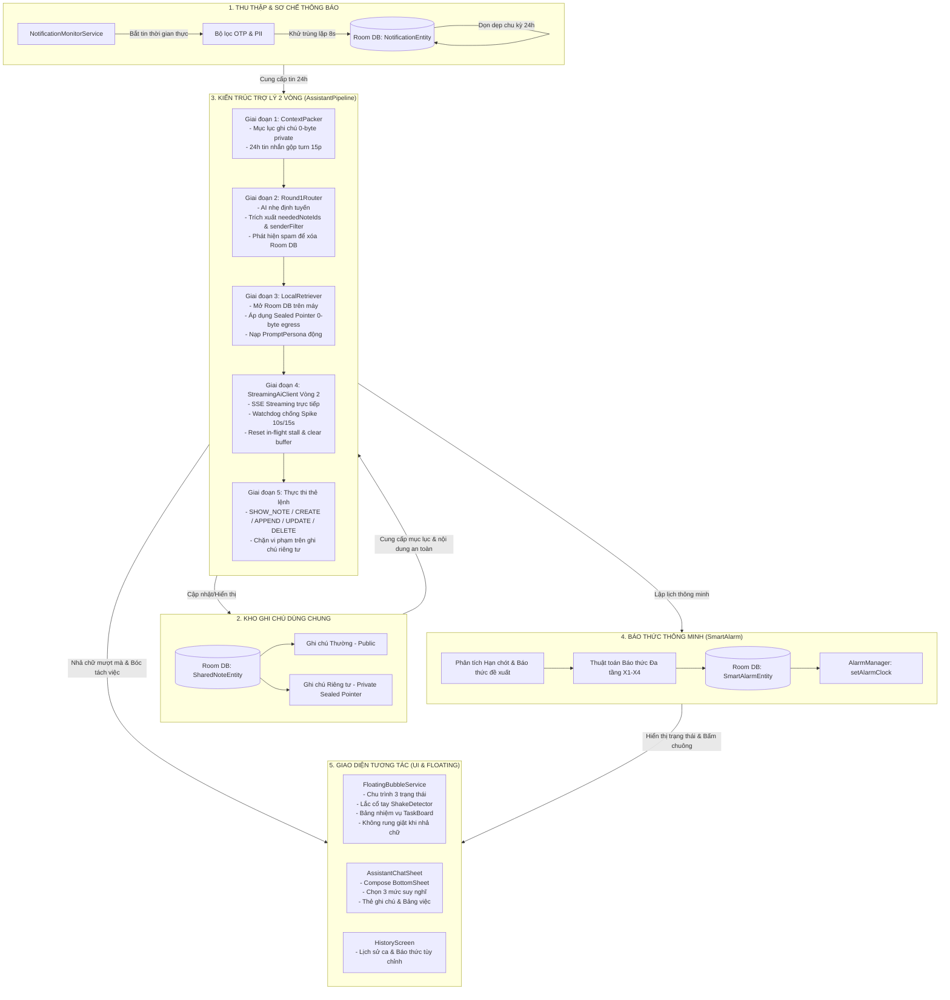
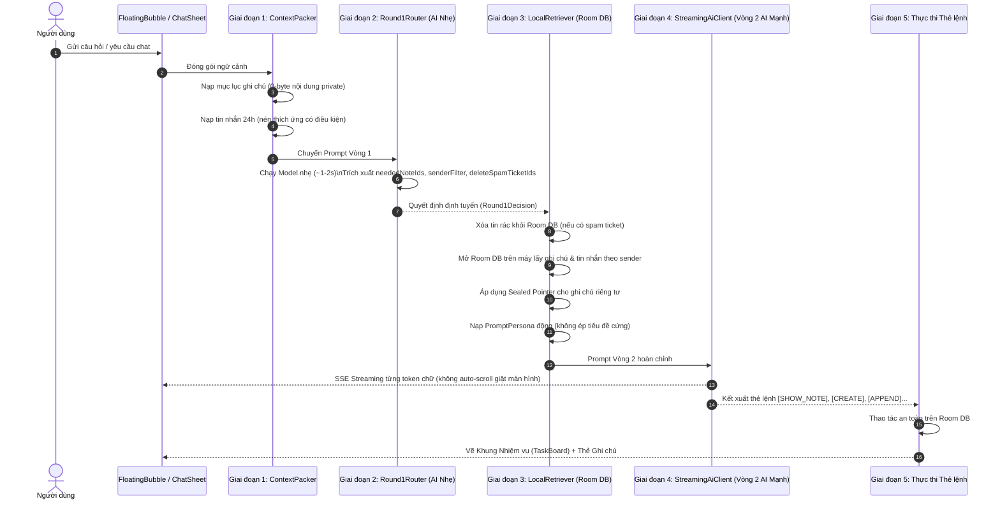
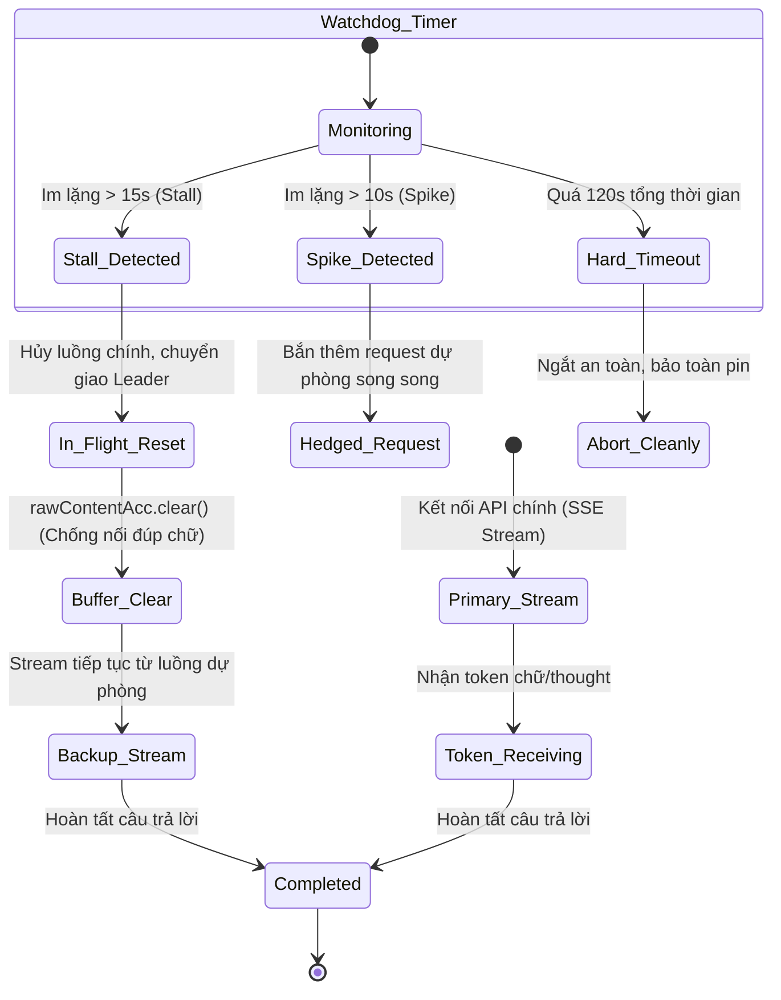

# 🗺️ BẢN ĐỒ & SƠ ĐỒ TÍNH NĂNG TOÀN DIỆN — ORCAAUTO (AItu)

> **Cập nhật:** Tháng 11/2026 — Nhánh `main` (Mã nguồn đã kiểm thử và hoạt động trên thiết bị thực)  
> **Mục đích:** Bóc tách toàn bộ hệ thống tính năng từ vĩ mô đến vi mô, làm rõ cơ chế liên kết giữa các thành phần, luồng xử lý dữ liệu, phương án dự phòng/bảo đảm an toàn tuyệt đối và hướng dẫn thao tác người dùng trực quan.

---

## 1. KIẾN TRÚC TỔNG THỂ & SƠ ĐỒ LIÊN KẾT LIÊN MODULE

OrcaAuto (AItu) được tổ chức theo kiến trúc module phân lớp rõ ràng, độc lập hoàn toàn giữa tác vụ xử lý thông báo ngầm và luồng tương tác tức thời của người dùng:

---

## 2. TRỤ CỘT 1: THU THẬP & SƠ CHẾ TIN NHẮN TỰ ĐỘNG (`NotificationMonitorService`)

### 2.1. Cơ chế hoạt động chi tiết
* **Lắng nghe hệ thống (`NotificationListenerService`):** Thu thập toàn bộ thông báo từ các ứng dụng nhắn tin và trao đổi công việc (Zalo, Telegram, Facebook Messenger, Gmail, Viber, Slack, Microsoft Teams, SMS, WhatsApp...).
* **Bộ lọc thông báo rác hệ thống:**
  * Bỏ qua các thông báo liên tục (ongoing), foreground service, media player (nhạc/video), trình tải file download, cập nhật ứng dụng ngầm.
  * Chỉ nhận thông báo có chứa văn bản hội thoại thực tế (`notification.extras.getCharSequence(EXTRA_TEXT)`).
* **Khử trùng lặp kép (Dual-tier Deduplication):**
  1. *Bộ nhớ đệm trong RAM (8 giây):* Dùng `ConcurrentHashMap` lưu `hash(sender + content + appName)`. Nếu trong 8 giây có thông báo trùng lặp (do app chat gửi 2 lần chuông), thông báo sau bị loại bỏ ngay lập tức ở mức 0ms.
  2. *Kiểm tra Room DB:* Kiểm tra nội dung trùng với tin nhắn đã lưu trong vòng 60 giây gần nhất.
* **Xử lý thu hồi & cập nhật tin nhắn:**
  * Khi đối phương thu hồi tin nhắn: Nhận diện nội dung `"Tin nhắn đã bị thu hồi"` hoặc `"Message recalled"` để cập nhật lại bản ghi trong DB thay vì nhân đôi.

### 2.2. Cơ chế lọc an toàn & Bảo vệ quyền riêng tư (PII)
* **Khử mã OTP tự động:** Sử dụng biểu thức chính quy (Regex) đa ngôn ngữ quét các mẫu OTP ngân hàng/dịch vụ (ví dụ: *"Ma OTP cua ban la 123456"*, *"Your verification code is..."*). Mã số được thay thế bằng `[MÃ_XÁC_THỰC_ĐÃ_ẨN]` trước khi lưu vào DB.
* **Chính sách phân tách PII trong xử lý:**
  * *Trong luồng tóm tắt ca định kỳ:* Ẩn bớt số điện thoại, email để chống rò rỉ dữ liệu ngoài ý muốn.
  * *Trong luồng chat tương tác trực tiếp (`AssistantPipeline`):* Giữ nguyên nội dung gốc (`sanitizePii = false`) để AI trả lời chính xác số điện thoại, mã đơn hàng, địa chỉ mà người dùng cần tra cứu.

### 2.3. Vòng đời dữ liệu (Data Lifecycle)
* **Cửa sổ 24 giờ:** Tin nhắn tự động được quét dọn sau 24 giờ kể từ thời điểm nhận.
* **Trần dung lượng an toàn (DB Capacity):** Giới hạn lưu trữ tối đa ~200 tin nhắn chưa xử lý trong DB. Khi vượt ngưỡng, hệ thống kích hoạt tóm tắt xả tràn (`BURST_UNPROCESSED_THRESHOLD = 80`) để tránh tràn RAM máy yếu.

---

## 3. TRỤ CỘT 2: KHO GHI CHÚ DÙNG CHUNG & BẢO MẬT CỤC BỘ (`SharedNoteVault`)

### 3.1. Phân loại ghi chú
Hệ thống lưu trữ ghi chú trong Room Database (`smart_notes`) với hai phân loại cốt lõi:
1. **Ghi chú Thường (`isPrivate = false`):**
   * Chứa thông tin công việc, ghi nhớ hàng ngày, công thức, số liệu chung.
   * AI có quyền đọc toàn bộ `title` và `content` để suy luận và trả lời người dùng.
2. **Ghi chú Riêng tư (`isPrivate = true` — Sealed Private Pointer):**
   * Dùng cho mật khẩu, mã két sắt, tài khoản ngân hàng, thông tin cá nhân bảo mật cao.
   * **Bảo đảm 0-byte Egress:** Tuyệt đối **0 byte nội dung** của ghi chú này được phép đọc vào bộ nhớ để gửi ra internet cho các máy chủ AI.

### 3.2. Cơ chế Sealed Private Pointer
Khi người dùng hỏi về ghi chú riêng tư (ví dụ: *"Mật khẩu két sắt là gì?"*):
* Vòng 1 thấy mục lục ghi chú: `ID: 2 | Mật khẩu két sắt | [RIÊNG TƯ] | Tạo: ... | Cập nhật: ...`.
* Vòng 1 chọn `neededNoteIds = [2]`.
* Vòng 3 (`LocalRetriever`) trích xuất ghi chú từ DB, phát hiện `isPrivate = true` -> Tạo con trỏ niêm phong `RetrievedNote.SealedPrivatePointer`:
  * `title`: "Mật khẩu két sắt"
  * `content`: **RỖNG (0 byte gửi đi)**
  * `pointerNotice`: Chỉ dẫn AI rằng nội dung được bảo vệ cục bộ, yêu cầu AI gọi thẻ lệnh `[SHOW_NOTE:2]`.
* Vòng 4 (AI phản hồi): AI trả lời: *"Ghi chú mật khẩu là riêng tư, mời bạn xem thẻ bên dưới: [SHOW_NOTE:2]"*.
* App bắt thẻ `[SHOW_NOTE:2]`, lấy nội dung từ Room DB trên máy và vẽ thẻ UI `🔒 Mật khẩu két sắt` hiển thị trực tiếp cho người dùng thấy trên màn hình điện thoại.

### 3.3. Các thẻ lệnh thao tác ghi chú của AI
AI được cấp 5 thẻ lệnh chuẩn hóa (phân cách bằng dấu gạch đứng `|` để không bị lỗi dấu hai chấm `:` trong giờ giấc):
1. `[SHOW_NOTE:id]`: Mở thẻ ghi chú cục bộ dưới câu trả lời (áp dụng cho cả thường và riêng tư).
2. `[CREATE: Tiêu đề | Nội dung | private/public]`: Tạo ghi chú mới vào DB.
3. `[APPEND: id | Nội dung thêm]`: Nối thêm nội dung vào cuối ghi chú (hỗ trợ cả ghi chú riêng tư).
4. `[UPDATE: id | Nội dung mới]`: Cập nhật toàn bộ ghi chú (CHỈ áp dụng cho ghi chú thường, cấm trên ghi chú riêng tư).
5. `[DELETE: id]`: Chuyển ghi chú thường vào thùng rác (CẤM trên ghi chú riêng tư).

---

## 4. TRỤ CỘT 3: KIẾN TRÚC TRỢ LÝ 2 VÒNG ĐỘC LẬP (`AssistantPipeline`)

Khắc phục triệt để điểm nghẽn của kiến trúc 1 vòng truyền thống (hoặc tốn quá nhiều token nếu nhồi toàn bộ dữ liệu, hoặc bảo mật kém). Luồng chạy độc lập khỏi `SequentialAiQueue.executionMutex`, người dùng chat là có phản hồi ngay.

### 4.1. Chi tiết 5 giai đoạn:
* **Giai đoạn 1 — Đóng gói ngữ cảnh (`ContextPacker`):**
  * *Neo thời gian thực:* In chính xác thứ, ngày, tháng, năm, giờ, phút và múi giờ hiện tại (`GMT+7`) để AI suy luận chuẩn các mốc thời gian *"sáng mai"*, *"thứ 6 tuần sau"*.
  * *Mục lục ghi chú:* In `id`, `title`, `isPrivate`, `createdAt`, `updatedAt` và cờ ghim `isPinned`.
  * *Tin nhắn 24h:* Sử dụng `MessageCoalescer` gộp các tin nhắn cùng người gửi trong vòng 15 phút thành 1 turn thoại duy nhất, giảm 60% số token thừa.
  * *Nén thích ứng có điều kiện:* Chỉ tóm tắt tin đã xử lý (`isProcessed = true`) khi tổng số tin vượt ngưỡng; toàn bộ tin chưa đọc (`isProcessed = false`) luôn giữ nguyên văn 100%.
* **Giai đoạn 2 — Định tuyến Vòng 1 (`Round1Router`):**
  * Ưu tiên các model siêu nhẹ, tốc độ cao (`gemini-3.5-flash-lite`, `llama-3.1-8b-instant`, `mistral-small-24b`).
  * Trả về JSON chứa `neededNoteIds`, `senderFilter`, `deleteSpamTicketIds`.
  * Có cơ chế Regex và đối soát tiếng Việt không dấu (`normalizeVietnamese`) tự động kích hoạt nếu model AI gặp sự cố.
* **Giai đoạn 3 — Truy xuất cục bộ & Sealed Pointer (`LocalRetriever`):**
  * Trích xuất nguyên văn tin nhắn gốc theo `senderFilter` và ghi chú đã chọn.
  * Nạp `PromptPersona` được người dùng chọn trong Cấu hình (`GENTLE_ASSISTANT`, `EXECUTIVE_SECRETARY`, `CRITICAL_ADVISOR`, `MINIMALIST`).
  * Chỉ dẫn AI trả lời tự nhiên, mạch lạc, **tuyệt đối không ép buộc chia tiêu đề cứng** *"Lời nhắn nhẹ nhàng / Lưu ý tinh tế"*.
* **Giai đoạn 4 — Phản hồi chính Vòng 2 & SSE Streaming (`StreamingAiClient`):**
  * Sử dụng các model thông minh nhất (`Gemini 3.8 Flash`, `nvidia/nemotron-3-ultra-550b...`).
  * Hỗ trợ chọn nhanh 3 mức suy nghĩ (**Nhanh** / **Cân bằng** / **Nghĩ sâu**) map trực tiếp sang `thinkingBudget` (Gemini) hoặc `reasoning.effort` (OpenRouter).
  * Lọc thời gian thực các thẻ lệnh hệ thống (`[SHOW_NOTE]`, `[APPEND]`) ra khỏi luồng chữ hiển thị cho người dùng.
* **Giai đoạn 5 — Thực thi thẻ lệnh & Bóc tách kết quả:**
  * Thực thi ngầm các tác vụ tạo, nối, cập nhật ghi chú vào Room DB.
  * Kiểm tra bảo mật: Từ chối ngay lập tức lệnh UPDATE/DELETE nếu trỏ vào ghi chú riêng tư.

---

## 5. TRỤ CỘT 4: ENGINE STREAMING CHỐNG SPIKE & WATCHDOG (`StreamingAiClient`)

Cơ chế phòng thủ đa tầng bảo đảm câu trả lời không bao giờ bị treo cứng, đứt đoạn hay lặp chữ:

### 5.1. Các thông số bảo đảm:
* **Spike Threshold (10 giây):** Nếu luồng stream im lặng quá 10 giây (do mạng nghẽn hoặc server AI quá tải), hệ thống tự động bắn thêm một request song song (**Hedged Request**) sang key/model dự phòng trong `keyPool`.
* **Stall Threshold (15 giây):** Nếu sau 15 giây luồng cũ vẫn không có phản hồi, watchdog quyết định hủy luồng cũ và chuyển giao quyền Leader cho luồng dự phòng.
* **Cơ chế chống nối đúp chữ (`isInFlightReset = true`):**
  * Khi luồng cũ bị hủy giữa chừng, hệ thống phát sự kiện `StreamUiEvent.SpikeDetected(..., isInFlightReset = true)`.
  * `AssistantPipeline` nhận diện cờ này sẽ lập tức xóa sạch bộ đệm chữ tích lũy dở dang (`rawContentAcc.clear()`), ngăn chặn triệt để lỗi nối nửa câu cũ vào câu mới của API dự phòng.
* **Trần thời gian cứng Hard Timeout (120 giây / 2 phút):** Toàn bộ phiên xử lý có hạn mức tối đa 2 phút, tự động ngắt nếu nhà mạng rớt mạng hoàn toàn, tránh ngốn pin máy ngầm.

---

## 6. TRỤ CỘT 5: HỆ THỐNG BÁO THỨC THÔNG MINH CHỐNG QUÊN (`SmartAlarmSystem`)

### 6.1. Thuật toán phân tích thời gian tự nhiên tiếng Việt (`parseDateTimeFromText`)
* Tự động nhận diện mọi biến thể thời gian:
  * Dạng giờ: `15:30`, `9h15`, `9h`, `14 giờ 30`, `3 giờ chiều`...
  * Dạng ngày cụ thể: `ngày 14/11/2026`, `15-11`, `20 tháng 11`...
  * Từ khóa tương đối: `hôm nay`, `sáng mai`, `ngày kia`, `ngày mốt`, `thứ 6 tuần sau`, `chiều tối nay`...
* Phân tách chính xác giữa **Thời hạn chót công việc (Deadline)** và **Báo thức đề xuất (Suggested Alarm)** khi AI tóm tắt ca.

### 6.2. Thuật toán Báo thức Đa tầng (Cascade Modes)
Người dùng có thể chọn 4 chế độ chuông báo để chống ngủ quên hoặc trễ việc hệ trọng:
* **X1 (Chuông đơn):** Báo đúng 1 mốc giờ hạn chót.
* **X2 (Chuông kép):** Báo trước 15 phút (chuông nhắc nhở nhẹ) + Báo đúng hạn chót (chuông chính).
* **X3 (Ba tầng):** Báo trước 30 phút + Trước 15 phút + Đúng hạn chót.
* **X4 (Bốn tầng dồn dập):** Báo trước 45 phút + Trước 30 phút + Trước 15 phút + Đúng hạn chót.

### 6.3. Cơ chế bảo đảm kỹ thuật & Chống báo thức ma
* **Định danh băm xác định (`ALM_hash`):** Mã băm được sinh từ `cleanTitle + targetCalendar`.
* **Khắc phục Race Condition:** Khi người dùng đổi mốc giờ tùy chỉnh, hệ thống sử dụng `disarmAlarmHardwareOnly` để hủy lịch trên `AlarmManager` mà không ghi đè cờ `CANCELLED` vào DB, đảm bảo trạng thái `ACTIVE` mới luôn chiến thắng.
* **Bảo lưu trạng thái 48 giờ:** Các nhiệm vụ đã bấm hủy (`CANCELLED`) được lưu giữ trong 48 giờ để ngăn AI tóm tắt tái sinh lại việc đó trong các ca làm việc tiếp theo.
* **Khôi phục sau khi khởi động máy (`BootReceiver`):** Khi điện thoại khởi động lại, `BootReceiver` tự động quét Room DB và nạp lại toàn bộ báo thức `ACTIVE` vào `AlarmManager` của hệ điều hành Android.

---

## 7. TRỤ CỘT 6: BONG BÓNG NỔI & GIAO DIỆN CHAT TRỰC QUAN

### 7.1. Chu trình 3 trạng thái của Bong bóng nổi (`FloatingBubbleService`)
1. **State 1 — Kích hoạt (Active 100%):** Sáng rõ, nhô ra mép kính. Tự động chuyển sang State 2 sau thời gian chờ.
2. **State 2 — Thu gọn mờ (Dimmed 20%):** Thu mình thành hình bán nguyệt mờ ở mép màn hình, không cản trở tầm nhìn người dùng.
3. **State 3 — Ẩn hoàn toàn (Hidden 0%):** Trả lại 100% diện tích cảm ứng màn hình cho các ứng dụng khác (chơi game, xem video).
* **Cảm biến lắc cổ tay (`ShakeDetector`):** Lắc cổ tay với gia tốc `12.0 m/s²` (3 nhịp đảo cực trong 750ms) để đánh thức bong bóng từ State 3 về State 2. Khi màn hình tắt, cảm biến tự động hủy đăng ký để tiết kiệm 100% pin.

### 7.2. Giao diện Chat tích hợp & Bảng nhiệm vụ tương tác
* **Gộp chung Lời chỉ dẫn + Bảng việc + Thẻ ghi chú:**
  * Khung trên cùng: Lời giải thích, câu trả lời hội thoại của AI.
  * Khung giữa: Bảng nhiệm vụ tương tác (`TaskBoard`) với mã màu (Đỏ = To-Do, Vàng = Planned, Xanh lá = Done), nút bấm hẹn giờ chuông báo và checkbox hoàn thành.
  * Khung dưới: Thẻ trích xuất ghi chú từ thiết bị (`LocalNoteCard`).
* **Triệt tiêu hiện tượng giật cuộn màn hình (Zero Scroll Jitter):**
  * Loại bỏ toàn bộ các lệnh cưỡng chế cuộn đáy (`fullScroll`, `scrollToItem`) trong suốt quá trình nhả chữ SSE streaming.
  * Màn hình giữ nguyên vị trí ổn định tuyệt đối, người dùng tự do đọc đoạn văn bản phía trên mà không bị cướp thao tác tay.

---

## 8. TRỤ CỘT 7: HỆ THỐNG ĐỌC GIỌNG NÓI TỰ ĐỘNG (`VoiceBriefingManager`)

* **Công nghệ TTS tiếng Việt chuẩn:** Tự động điều chỉnh ngữ điệu, tốc độ đọc êm ái.
* **Cơ chế bóc tách nội dung tóm lược thông minh:**
  * Bỏ qua các ký tự markdown rườm rà (`**`, `##`, `---`).
  * Tự động lọc bỏ các nhiệm vụ đã bị hủy (`CANCELLED`).
  * Đọc lời nhắn tổng quan trước, sau đó đọc lần lượt từng nhiệm vụ cần làm kèm mốc giờ hạn chót.
* **Thao tác 1 chạm để dừng:** Nhấn vào bong bóng chat hoặc thẻ báo cáo để ngắt giọng nói ngay lập tức khi đang ở nơi đông người.

---

## 9. TRỤ CỘT 8: QUẢN LÝ ĐA PHIÊN & ĐA NHÀ CUNG CẤP AI

### 9.1. Quản lý Đa phiên (Multi-Session Engine)
* Cho phép tạo không giới hạn các phiên làm việc độc lập (ví dụ: *Ca Sáng*, *Ca Tối*, *Dự án Orca*, *Việc Gia Đình*...).
* Mỗi phiên sở hữu cấu hình riêng biệt:
  * Nguồn ứng dụng theo dõi (Zalo, Telegram, Slack...).
  * Từ khóa cần bắt / Người gửi ưu tiên.
  * Chỉ thị bổ sung riêng của phiên.
  * Phong cách trợ lý riêng (`PromptPersona`).

### 9.2. Hệ thống Khóa API Đa Nền Tảng (Multi-Provider Key Pool)
* Hỗ trợ 6 nền tảng AI phổ biến: **Google Gemini**, **OpenRouter**, **Groq LPU**, **DeepSeek**, **NVIDIA NIM**, **OpenAI**.
* Tự động nhận diện nhà cung cấp qua tiền tố Key (`AIzaSy...`, `gsk_...`, `sk-or-...`, `nvapi-...`).
* **Cơ chế Failover Pool tự động:** Khi một key hoặc nhà cung cấp bị cạn hạn ngạch (429 Rate Limit) hoặc lỗi mạng (503 Service Unavailable), hệ thống tự động trượt sang Key tiếp theo trong danh sách mà không làm gián đoạn trải nghiệm người dùng.

---

## 10. MA TRẬN LIÊN KẾT GIỮA CÁC TÍNH NĂNG (INTER-MODULE DEPENDENCY)

| Module Nguồn | Module Đích | Cơ Chế Tương Tác / Giao Tiếp | Mục Đích & Bảo Đảm Kỹ Thuật |
| :--- | :--- | :--- | :--- |
| **NotificationMonitor** | **Room DB** | DAO Insert qua Coroutines IO | Lưu trữ tin nhắn 24h, khử OTP, lọc PII |
| **Room DB (Notes)** | **ContextPacker** | `getCatalogNotes()` (Tuples) | Đóng gói mục lục 0-byte nội dung riêng tư |
| **ContextPacker** | **Round1Router** | Prompt Vòng 1 gọn nhẹ | Định tuyến nhẹ 1-2 giây, trích xuất ID & sender |
| **Round1Router** | **NotificationDao** | `deleteNotificationsByIds()` | Xóa tin nhắn rác (Spam) trực tiếp khỏi DB |
| **Round1Router** | **LocalRetriever** | `Round1Decision` (DTO) | Cung cấp danh sách ID ghi chú và bộ lọc người gửi |
| **LocalRetriever** | **StreamingAiClient**| `RetrievedContext` (DTO) | Chuyển prompt Vòng 2 kèm phong cách `PromptPersona` |
| **StreamingAiClient**| **AssistantPipeline**| Flow `StreamUiEvent` | Bắn token SSE, Watchdog Hedged Request, Reset buffer |
| **AssistantPipeline**| **FloatingBubble** | Flow `AssistantUiState` | Hiển thị trạng thái, nhả chữ không rung giật |
| **AssistantPipeline**| **SharedNoteDao** | `executeCommand()` | Thực thi lệnh SHOW/CREATE/APPEND, bảo vệ private |
| **AssistantPipeline**| **SmartAlarmDao** | `SummaryParser.parse()` | Bóc tách việc từ câu trả lời chat, vẽ TaskBoard |
| **SmartAlarmHelper** | **AlarmManager** | `setAlarmClock()` | Lên lịch chuông báo thức chính xác đến từng phút |
| **ShakeDetector** | **FloatingBubble** | Listener cảm biến gia tốc | Đánh thức bóng chat khi lắc tay (ngắt khi tắt màn hình) |

---

## 11. BẢNG TỔNG HỢP CƠ CHẾ DỰ PHÒNG & AN TOÀN

| Rủi Ro Kỹ Thuật Tiềm Ẩn | Cơ Chế Dự Phòng & Giải Pháp Bảo Đảm | Vị Trí Code Chịu Trách Nhiệm |
| :--- | :--- | :--- |
| **Rò rỉ dữ liệu nhạy cảm ra AI** | **Sealed Private Pointer:** Ghi chú `isPrivate = true` chỉ gửi ID và tiêu đề ra mạng, nội dung 0 byte; chỉ mở trực tiếp trên màn hình máy. | `LocalRetriever.kt`, `SharedNoteRepositoryImpl.kt` |
| **Lặp chữ khi mạng chập chờn** | **In-flight Reset Buffer:** Khi Watchdog chuyển giao Leader, xóa sạch bộ đệm `rawContentAcc.clear()` không nối câu cũ. | `StreamingAiClient.kt`, `AssistantPipeline.kt` |
| **Treo luồng / Đơ ứng dụng** | **Watchdog Hedged Request & Hard Timeout:** Bắn thêm request dự phòng sau 10s, chuyển giao sau 15s, trần cứng 120s. | `StreamingAiClient.kt` |
| **Lệch giờ / Sai ngày tháng** | **Real-time Anchor Line:** Bắt buộc chèn ngày thứ, ngày tháng năm và giờ phút GMT+7 vào đầu mọi prompt Vòng 1 và Vòng 2. | `ContextPacker.kt`, `LocalRetriever.kt` |
| **Mất chuông khi khởi động lại** | **BootReceiver Auto-Reschedule:** Lắng nghe `BOOT_COMPLETED`, quét Room DB nạp lại 100% báo thức `ACTIVE`. | `BootReceiver.kt`, `SystemAlarmHelper.kt` |
| **Xung đột hủy chuông (Race Condition)** | **Disarm Hardware Only:** Khi sửa giờ tùy chỉnh, chỉ hủy `AlarmManager` cũ, giữ giao dịch Room DB đơn luồng cho trạng thái mới. | `SystemAlarmHelper.kt`, `HistoryScreen.kt` |
| **Báo thức ma kêu sai giờ** | **DB Status Check trước khi kêu:** `SmartAlarmReceiver` kiểm tra DB ngay tại thời điểm kích hoạt; nếu đã hủy thì chặn chuông ngay. | `SmartAlarmReceiver.kt` |
| **Tốn pin vì cảm biến chạy ngầm** | **Screen-Off Unregister:** Đăng ký `ACTION_SCREEN_OFF` để ngắt hoàn toàn cảm biến lắc tay khi tắt màn hình. | `FloatingBubbleService.kt` |
| **Rung lắc giao diện khi nhả chữ** | **Zero Auto-Scroll:** Loại bỏ hoàn toàn auto-scroll trong lúc stream, giữ nguyên vị trí cuộn của người dùng. | `FloatingBubbleService.kt`, `AssistantChatSheet.kt` |

---

## 12. HƯỚNG DẪN THAO TÁC SỬ DỤNG THỰC TẾ

### 12.1. Thao tác với Bong bóng nổi (Floating Bubble)
* **Mở xem tóm tắt ca:** Chạm 1 chạm vào bong bóng nổi khi đang ở State 1 hoặc State 2. Thẻ tóm tắt sẽ bung ra hiển thị Lời khuyên, Bảng việc và Ô nhập chat.
* **Đánh thức khi bong bóng ẩn:** Lắc nhẹ cổ tay 2-3 nhịp để bong bóng hiện lại ở mép màn hình.
* **Tắt chuông báo thức tức thì:** Khi chuông báo thức đến hạn reo lên, chỉ cần chạm vào bong bóng chat là âm thanh lập tức tắt ngay.
* **Kéo thả di chuyển vị trí:** Giữ và kéo bong bóng đến vị trí mong muốn dọc hai mép màn hình; bong bóng tự động hít nhẹ vào cạnh kính gần nhất.

### 12.2. Thao tác Chat tương tác với Trợ lý AI
* **Hỏi đáp thông tin:** Gõ câu hỏi vào ô nhập ở đáy bong bóng (hoặc AssistantChatSheet trong app) -> Bấm **Gửi**.
* **Đổi mức suy nghĩ:** Chạm vào 1 trong 3 nút phía trên ô nhập:
  * `⚡ Nhanh`: Trả lời chớp nhoáng cho câu hỏi tra cứu đơn giản.
  * `⚖ Cân bằng`: Mức tiêu chuẩn, cân bằng giữa tốc độ và độ chuẩn xác.
  * `🧠 Sâu sắc`: Dành cho các câu hỏi logic phức tạp hoặc lập kế hoạch đa bước.
* **Thao tác với thẻ ghi chú xuất hiện trong chat:**
  * Nhấn vào thẻ ghi chú để mở xem chi tiết hoặc chỉnh sửa trực tiếp.
* **Thao tác với nhiệm vụ xuất hiện trong chat:**
  * Nhấn vào nút chuông `🔔 Đặt [giờ]` để hẹn giờ báo thức ngay cho công việc vừa chat.
  * Vuốt ngang từ trái sang phải để đánh dấu hoàn thành công việc.

### 12.3. Thao tác Đặt báo thức tùy chỉnh trong Lịch sử ca (`HistoryScreen`)
* **Đặt nhanh:** Chạm vào nút `🔔 Đặt [giờ]` trên thẻ nhiệm vụ -> Hệ thống lên lịch báo thức chuông đơn và nút chuyển sang màu xanh lá `✓ Đã đặt`.
* **Đặt tùy chỉnh nâng cao:** Nhấn giữ (long press) vào thẻ nhiệm vụ:
  * Hộp thoại mở ra cho phép tùy chỉnh giờ, phút, chế độ đa tầng (X1, X2, X3, X4) và nhập ghi chú dặn dò AI cho ca sau.
  * Bấm **Lưu thay đổi** -> Nút chuông ngoài màn hình cập nhật ngay mốc giờ tùy chỉnh kèm dấu tích xanh `✓ [Giờ tùy chỉnh]`.
* **Hủy báo thức:** Nhấn giữ vào thẻ nhiệm vụ -> Chọn nút đỏ *"Hủy bỏ chuông báo này"* -> Thẻ nhiệm vụ chuyển sang trạng thái đã hủy và không tái sinh trong 48 giờ.
